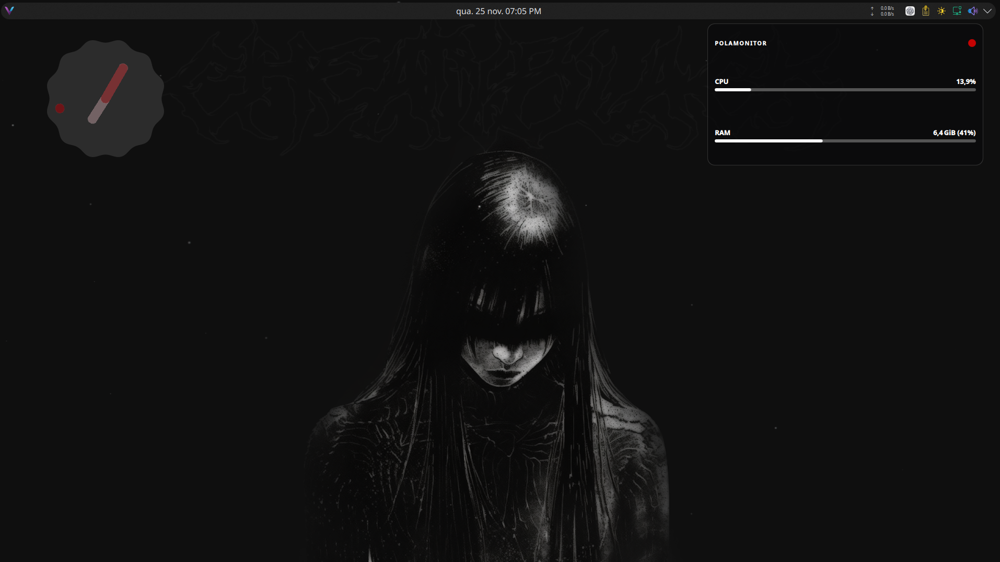

# PolaMonitor

A minimalist system monitoring widget for KDE Plasma 6, built with QML.

PolaMonitor is a personal project developed as part of **PolaLab**, focused on learning Linux, QML, KDE Plasma development and system monitoring.

## Features

- CPU monitoring.
- RAM monitoring.
- Minimalist interface.
- Dark theme with cyan accents.
- Native KDE Plasma integration.

*Features may change as development progresses.*

## Preview



## Technologies

- QML
- Qt 6
- KDE Plasma 6
- KSysGuard Sensors API
- Fedora Linux (development environment)

## Project Structure

```text
PolaMonitor/
├── README.md
├── LICENSE
├── metadata.json
├── contents/
│   └── ui/
│       └── main.qml
├── docs/
│   ├── architecture.md
│   └── development-notes.md
└── screenshots/
    └── polamonitor.png
```

## Development

PolaMonitor is being developed as a learning project. The goal is not only to create a functional widget, but also to understand the technologies and concepts behind it.

For more details, see:

- [Architecture](docs/architecture.md)
- [Development Notes](docs/development-notes.md)

## License

This project is licensed under the MIT License. See [LICENSE](LICENSE) for details.

---

Developed as part of **PolaLab**.
